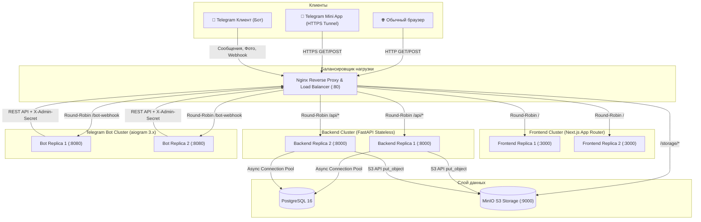

# Архитектура и описание решения (Tinvix Microservice)

## 1. Обзор архитектуры

Микросервисный комплекс разработан в строгом соответствии с требованиями практического задания:
- **Stateless дизайн**: ни один из масштабируемых сервисов (Backend, Frontend, Telegram Bot) не хранит локального состояния на диске или в оперативной памяти конкретного инстанса.
- **Безопасность API**: эндпоинты создания товаров (`POST /api/products` и `POST /api/products/upload`) защищены обязательным заголовком `X-Admin-Secret`, исключающим создание товаров в обход прав администратора.
- **Идемпотентность**: создание товаров использует уникальный идентификатор файла Telegram (`telegram_file_id`), исключая дубликаты при повторной доставке апдейтов Telegram.
- **Отказоустойчивость и балансировка**: сервисы разворачиваются в 2+ репликах и балансируются через обратный прокси Nginx с автоматическим failover (`proxy_next_upstream error timeout http_502 http_503 http_504`).
- **Объектное хранилище**: MinIO S3 для надёжного распределённого хранения фотографий товаров. Фотографии отдаются через Nginx по относительному пути `/storage/products/<file>`, что исключает проблему `localhost` на мобильных устройствах и в TMA.
- **Реляционная СУБД**: PostgreSQL 16 с асинхронным доступом через SQLAlchemy 2.0 (`asyncpg`). Реализовано сохранение товаров и заказов (`Order`, `OrderItem`).
- **Telegram Mini App (TMA)**: нативная интеграция Next.js 14 App Router с Telegram WebApp SDK, обеспечивающая идентичную работу как в десктопном/мобильном браузере, так и внутри клиента Telegram.

---

## 2. Схема взаимодействия компонентов

---

## 3. Сценарии работы

### 3.1. Создание товара администратором
1. Пользователь обращается к боту. Если его ID **не входит** в список `ADMIN_IDS`:
   - При попытке создания товара бот вежливо отказывает и выводит его фактический Telegram ID: `🚫 У вас нет прав администратора. Ваш Telegram ID: <id>`.
2. Если пользователь — подтверждённый администратор (указан в `ADMIN_IDS`):
   - Нажимает кнопку **«➕ Создать товар»** или вводит команду `/create`.
   - Бот сообщает формат: **название и фото в одном сообщении** (caption + photo).
   - Администратор отправляет фото с подписью.
   - Обработчик aiogram скачивает файл **исключительно в оперативную память** (`io.BytesIO`), соблюдая требование stateless (никаких локальных файлов на диске).
   - Бот передаёт данные в метод бэкенда `POST /api/products/upload` с заголовком безопасности `X-Admin-Secret` и уникальным `telegram_file_id`.
   - Бэкенд проверяет уникальность `telegram_file_id` (защита от дубликатов при сетевых повторах), загружает бинарный поток в MinIO и сохраняет запись в PostgreSQL.
   - Возвращает подтверждение с ID, названием и кнопкой для мгновенного перехода в каталог.

### 3.2. Просмотр каталога и оформление заказа
1. Пользователь обращается к боту (`/start` или любое текстовое сообщение).
2. Бот отвечает: **«У меня есть товар»** и прикрепляет кнопку открытия каталога Mini App.
3. Каталог открывается в браузере или Telegram Mini App:
   - Next.js загружает данные через `/api/products`.
   - Фотографии подгружаются по относительному пути `/storage/products/<file>` через Nginx, что гарантирует работу на мобильных устройствах без привязки к `localhost`.
   - Пользователь может добавить товар в корзину и нажать **«Оформить заказ»**.
   - Фронтенд отправляет `POST /api/orders` с товарами и данными пользователя из `initDataUnsafe`.
   - Заказ сохраняется в PostgreSQL в таблицах `orders` и `order_items`.

---

## 4. Доказательство Stateless и работы в нескольких инстансах

1. **Заголовок `X-Handled-By`**: Nginx передаёт адрес конкретной реплики бэкенда (`172.23.0.x:8000`) или фронтенда (`172.23.0.x:3000`).
2. **Идентификатор инстанса**: Эндпоинт `/api/health` возвращает `instance_id` (hostname + PID). При последовательных запросах видно чередование реплик.
3. **Отказоустойчивость (Failover)**: При остановке одной из реплик (`docker compose stop backend-1`) Nginx автоматически перенаправляет 100% трафика на оставшуюся реплику без прерывания обслуживания клиентов благодаря директиве `proxy_next_upstream`.
4. **Масштабирование бота**: Бот поддерживает режим `BOT_MODE=webhook`, что позволяет запускать 2+ реплики бота за Nginx без конфликтов long polling.
